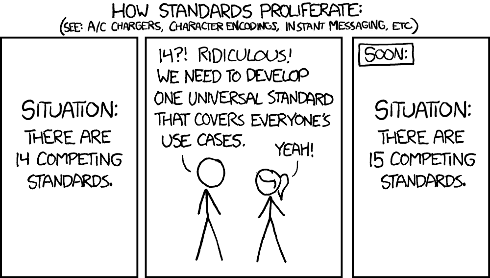

~.toc

- [Data in Applications](#data-in-applications)
  - [Data Capture](#data-capture)
  - [Data Storage](#data-storage)
  - [Open vs Proprietary File Formats](#open-vs-proprietary-file-formats)
  - [Interoperability](#interoperability)
  - [Vendor Lock-in](#vendor-lock-in)

/~

# Data in Applications

From an informatics perspective, an application is largely a machine for **capturing**, **storing**, and **exchanging** data.

## Data Capture

How does data get _into_ an application?

- **Forms**: A patient intake form, a course registration page
- **Sensors**: GPS in a phone, a heart-rate monitor, a barcode scanner
- **Imports**: Uploading a spreadsheet or loading a file exported from another system
- **User-generated content**: Posts, photos, reviews, and comments

## Data Storage

| Storage Approach | Description                                                     | Example                          |
| ---------------- | --------------------------------------------------------------- | -------------------------------- |
| Local files      | Data saved as files on the user's own device                    | A `.docx` file in your Documents |
| Databases        | Structured data managed by a database system, often on a server | A library's catalog of holdings  |
| Cloud storage    | Data stored on a provider's servers and synced across devices   | OneDrive, Google Drive, iCloud   |

## Open vs Proprietary File Formats

- **Open format**: The specification is published, and anyone may build software that reads or writes it (e.g., `.csv`, `.txt`, `.png`, `.pdf`, `.odt`)
- **Proprietary format**: The specification is controlled by one company, and may be undocumented or restricted (e.g., `.psd` for Photoshop, older `.doc` files)

Why does this matter?

- **Longevity**: Will you still be able to open the file in 20 years - after the company is gone?
- **Choice**: Can you switch to a different application without losing your work?
- **Fidelity**: Formatting is often lost or garbled when one application "translates" another's proprietary format.

~.focusContent.demo

**Same File, Different Applications**

Open the same `.docx` file in Microsoft Word, Google Docs, and LibreOffice Writer. What changes? Look at fonts, page breaks, comments, and tracked changes.

Then open a `.csv` file in a spreadsheet application _and_ in a plain text editor. Why does the `.csv` look the same everywhere?

/~

## Interoperability

**Interoperability** is the ability of different systems to exchange data and make use of it. This depends on:

- **Exchange formats**: Common formats both systems understand (CSV, JSON, XML)
- **APIs**: Defined ways for one application to request data from another
- **Standards**: Agreements, often industry-specific, about how data is structured
  - **HL7 FHIR**: Exchanging electronic health records
  - **MARC 21**: Describing items in library catalogs

<figure>
    
        
    
    <figcaption>
        

        Source: <a href="https://xkcd.com/927/">xkcd: Standards</a> (CC BY-NC 2.5)
        

    </figcaption>
</figure>

~.focusContent.example

**Moving Records Between Systems**

A clinic is switching from one electronic health record system to another. Questions to ask:

- Can the old system export _all_ of the data, or only some of it?
- Do both systems support a common standard (e.g., FHIR)?
- Do fields line up? One system may store "Name" as a single field while the other uses "First" and "Last."
- What happens to attachments, scanned documents, and audit history?

The same questions come up when a library moves its catalog from one integrated library system to another.

/~

## Vendor Lock-in

**Vendor lock-in** occurs when switching away from a product is so costly or difficult that an organization is effectively stuck with it.

How it arises:

- Data stored in proprietary formats, or with limited export options
- Custom workflows and integrations built around one product
- Staff training and habits tied to one interface
- Multi-year contracts and bundled pricing

~.focusContent.lookout

**The Cost of Lock-in**

A locked-in organization loses its bargaining power. When the vendor raises prices, discontinues a feature, or is acquired by another company, the organization has little choice but to accept it. Ask about data export **before** adopting software, not after.

/~
