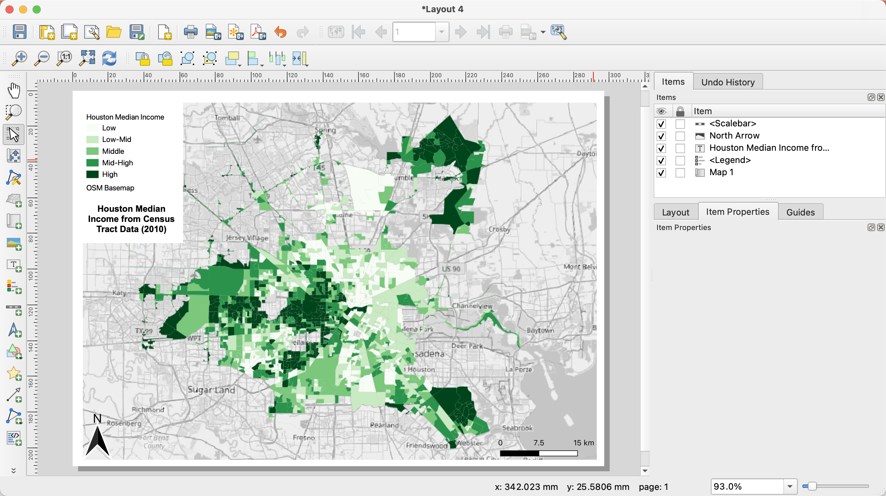

~.toc

- [Application Software in Informatics](#application-software-in-informatics)
  - [Overview](#overview)
  - [A Taxonomy of Application Software](#a-taxonomy-of-application-software)
    - [By Purpose](#by-purpose)
    - [By Delivery](#by-delivery)
      - [By Platform](#by-platform)
      - [By Hosting Model](#by-hosting-model)

/~

# Application Software in Informatics

## Overview

~.focusContent.exercise

**Warm-up:**

How many distinct applications did you use before arriving today? Count them - alarm clock, messaging, maps, music, email, a bank app, a learning management system...

/~

**Application software** is software that performs tasks _for users_ - writing a paper, booking an appointment, analyzing a dataset. This is in contrast to **system software**, which manages the computer itself (we'll cover that next lecture).

From an informatics point of view, applications are where **people**, **data**, and **organizational goals** meet.

Software must support the entire **information system**:

> A hospital's records system isn't just a program - it's also the nurses who use it, the patient data inside it, and the hospital's need to deliver (and bill for) care.

## A Taxonomy of Application Software

There are thousands of applications, so it helps to sort them. We'll use two lenses: **what the application is for** (purpose) and **how it reaches the user** (delivery). Delivery itself has two questions - which device or interface you use, and who hosts and maintains the software.

### By Purpose

| Category                        | What it does                                 | Examples                                                        |
| ------------------------------- | -------------------------------------------- | --------------------------------------------------------------- |
| Productivity                    | General-purpose document and data work       | Word processors, spreadsheets, presentation software            |
| Enterprise Systems              | Run the core operations of an organization   | ERP (SAP), CRM (Salesforce), supply chain management            |
| Domain-Specific                 | Serve the needs of one field or profession   | Electronic health records (EHR), GIS, library systems, SPSS / R |
| Creative and Media              | Create and edit images, audio, and video     | Photoshop, GIMP, Audacity, DaVinci Resolve                      |
| Communication and Collaboration | Help people talk to and work with each other | Email, Slack, Zoom, Microsoft Teams, shared workspaces (Notion) |

~.focusContent.note

**Enterprise Acronyms**

If you work in a certain domain, you will start to learn its jargon. This includes acronyms, such as the below. Each has its own class of software tools:

- **ERP (Enterprise Resource Planning)**: Ties together finance, HR, purchasing, and inventory into one shared system
- **CRM (Customer Relationship Management)**: Tracks every interaction an organization has with its customers
- **SCM (Supply Chain Management)**: Tracks goods from suppliers, through production, to customers

/~

~.focusContent.example

**Domain-Specific Software: GIS**

<figure>
    
        
    
    <figcaption>
        

        Source: <a href="https://commons.wikimedia.org/wiki/File:QGIS_Interface_Screenshot_with_Map_of_Median_Income_in_Houston_(2010).png">Wikimedia Commons</a> (CC0)
        

    </figcaption>
</figure>

A **Geographic Information System (GIS)** such as QGIS or ArcGIS combines map data with other data - here, census income data - so that patterns can be seen spatially. City planners, public health departments, and emergency services all depend on GIS software.

/~

~.focusContent.example

**Communication Software: Email Basics**

- **To**: The people the email is for. They are expected to read and respond.
- **CC (Carbon Copy)**: People who should be kept in the loop, but aren't expected to act. Everyone can see who was CC'd.
- **BCC (Blind Carbon Copy)**: Recipients hidden from everyone else. Use this when emailing a large group of people who don't know each other.
- **Reply**: Responds only to the sender.
- **Reply All**: Responds to the sender _and_ everyone in To and CC. Use sparingly!
- **Forward**: Sends the email - including the earlier thread below it - to someone new. Check what's in the thread first.

/~

### Delivery Considerations

#### Platform

_Where do you interact with the application?_

| Platform            | Where you use it              | Examples                        |
| ------------------- | ----------------------------- | ------------------------------- |
| Desktop / installed | Your computer                 | Microsoft Excel (desktop), GIMP |
| Mobile              | Your phone or tablet          | Instagram, your bank's app      |
| Web (browser)       | Any device with a web browser | Google Docs, Canvas LMS         |

Many products ship on more than one platform. Microsoft Teams, for example, is a desktop app, a mobile app, _and_ a web app - all sharing the same cloud data.

#### Hosting Model

_Who runs and maintains the software behind the scenes?_

| Hosting Model                   | Who runs it                                 | Who maintains it         | Examples                                     |
| ------------------------------- | ------------------------------------------- | ------------------------ | -------------------------------------------- |
| Locally installed / on-premises | Your machine or your organization's servers | You / your IT department | GIMP, a hospital's on-site EHR server        |
| Software as a Service (SaaS)    | The provider's cloud, by subscription       | The provider             | Salesforce, Microsoft 365, Zoom, Google Docs |

Platform and hosting are not the same axis. A desktop app can still be SaaS (Outlook connected to Microsoft 365). A web app can be hosted by your own IT department rather than sold as a subscription product.

~.focusContent.lookout

**Who Controls SaaS?**

With locally installed software, _you_ decide when (or if) to update. With SaaS, the vendor can change features, pricing, or terms of service overnight - and your data lives on their servers. The shift to SaaS has quietly moved control from the user to the provider.

/~

**Activity: The Taxonomy Grid**

In class, let's place five applications you use regularly on the grid below (purpose × platform). Then, for each one, say whether it is mainly **locally hosted** or **SaaS**.

|                    | Desktop | Mobile | Web |
| ------------------ | ------- | ------ | --- |
| Productivity       |         |        |     |
| Enterprise         |         |        |     |
| Domain-Specific    |         |        |     |
| Creative and Media |         |        |     |
| Communication      |         |        |     |

/~
