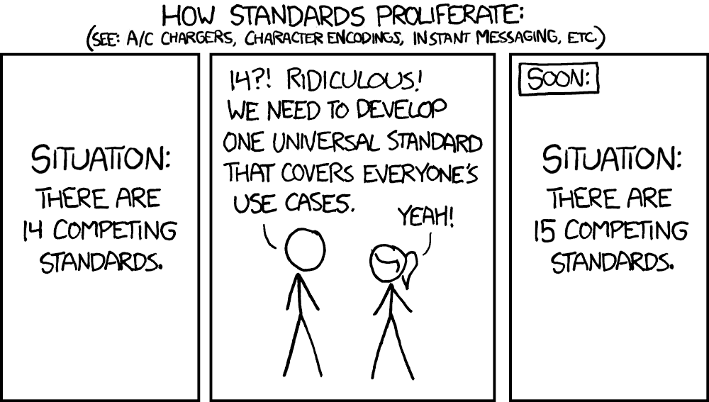
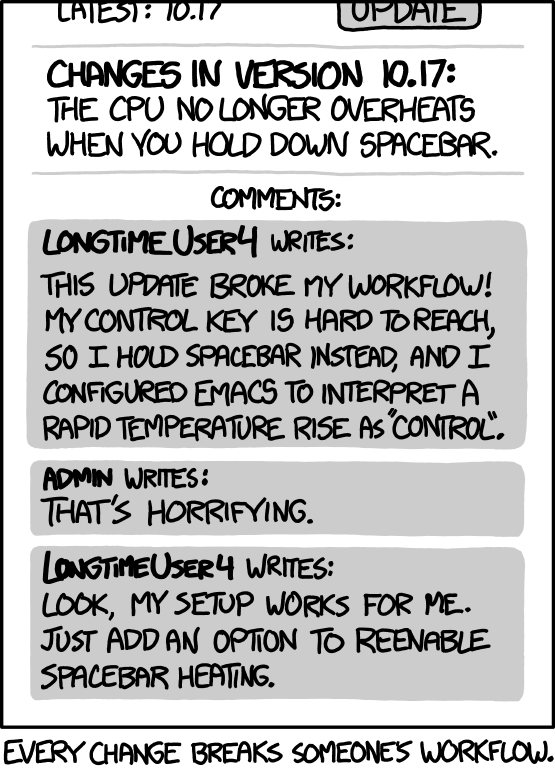
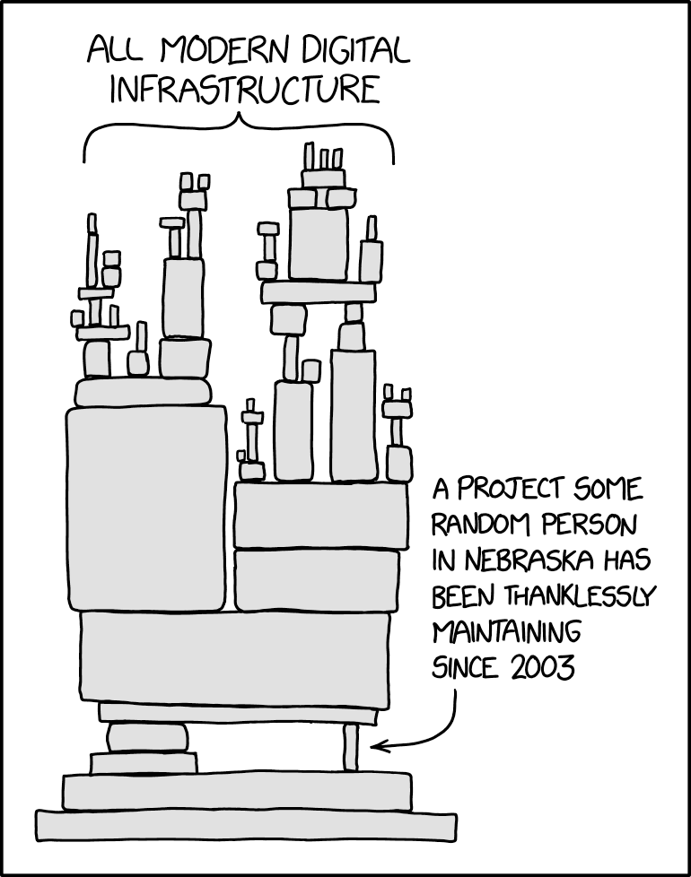

~.toc

- [Application Software in Informatics](#application-software-in-informatics)
  - [Learning Objectives](#learning-objectives)
  - [Overview](#overview)
  - [A Taxonomy of Application Software](#a-taxonomy-of-application-software)
    - [By Purpose](#by-purpose)
    - [By Delivery](#by-delivery)
      - [By Platform](#by-platform)
      - [By Hosting Model](#by-hosting-model)
  - [Applications and the Operating System](#applications-and-the-operating-system)
    - [What the OS Provides](#what-the-os-provides)
    - [Why Applications Are Platform Specific](#why-applications-are-platform-specific)
  - [Data in Applications](#data-in-applications)
    - [Data Capture](#data-capture)
    - [Data Storage](#data-storage)
    - [Open vs Proprietary File Formats](#open-vs-proprietary-file-formats)
    - [Interoperability](#interoperability)
    - [Vendor Lock-in](#vendor-lock-in)
  - [Humans and Applications](#humans-and-applications)
    - [Usability](#usability)
    - [Accessibility](#accessibility)
    - [Why Good Software Gets Rejected](#why-good-software-gets-rejected)
  - [Selecting and Adopting Software](#selecting-and-adopting-software)
    - [Commercial vs Open Source](#commercial-vs-open-source)
    - [Build vs Buy](#build-vs-buy)
    - [Licensing Models](#licensing-models)
    - [Total Cost of Ownership](#total-cost-of-ownership)
    - [Integration and Legacy Systems](#integration-and-legacy-systems)
    - [Change Management](#change-management)
  - [Critical Perspectives](#critical-perspectives)
    - [Privacy and Telemetry](#privacy-and-telemetry)
    - [The Subscription Economy](#the-subscription-economy)
    - [Obsolescence and End of Support](#obsolescence-and-end-of-support)
    - [Dark Patterns and Default Settings](#dark-patterns-and-default-settings)
  - [Summary](#summary)

/~

# Application Software in Informatics

## Overview

~.focusContent.exercise

**Warm-up:**

How many distinct applications did you use before arriving today? Count them - alarm clock, messaging, maps, music, email, a bank app, a learning management system...

/~

**Application software** is software that performs tasks _for users_ - writing a paper, booking an appointment, analyzing a dataset. This is in contrast to **system software**, which manages the computer itself (we'll cover that next lecture).

From an informatics point of view, applications are where **people**, **data**, and **organizational goals** meet.

Software must support the entire **information system**:

- A hospital's records system isn't just a program - it's also the nurses who use it, the patient data inside it, and the hospital's need to deliver (and bill for) care.

## A Taxonomy of Application Software

There are thousands of applications, so it helps to sort them. We'll use two lenses: **what the application is for** (purpose) and **how it reaches the user** (delivery). Delivery itself has two questions - which device or interface you use, and who hosts and maintains the software.

### By Purpose

| Category                        | What it does                                 | Examples                                                        |
| ------------------------------- | -------------------------------------------- | --------------------------------------------------------------- |
| Productivity                    | General-purpose document and data work       | Word processors, spreadsheets, presentation software            |
| Enterprise Systems              | Run the core operations of an organization   | ERP (SAP), CRM (Salesforce), supply chain management            |
| Domain-Specific                 | Serve the needs of one field or profession   | Electronic health records (EHR), GIS, library systems, SPSS / R |
| Creative and Media              | Create and edit images, audio, and video     | Photoshop, GIMP, Audacity, DaVinci Resolve                      |
| Communication and Collaboration | Help people talk to and work with each other | Email, Slack, Zoom, Microsoft Teams, shared workspaces (Notion) |

~.focusContent.note

**Enterprise Acronyms**

If you work in a certain domain, you will start to learn its jargon. This includes acronyms, such as the below. Each has its own class of software tools:

- **ERP (Enterprise Resource Planning)**: Ties together finance, HR, purchasing, and inventory into one shared system
- **CRM (Customer Relationship Management)**: Tracks every interaction an organization has with its customers
- **SCM (Supply Chain Management)**: Tracks goods from suppliers, through production, to customers

/~

~.focusContent.example

**Domain-Specific Software: GIS**

<figure>
    
        
    
    <figcaption>
        

        Source: <a href="https://commons.wikimedia.org/wiki/File:QGIS_Interface_Screenshot_with_Map_of_Median_Income_in_Houston_(2010).png">Wikimedia Commons</a> (CC0)
        

    </figcaption>
</figure>

A **Geographic Information System (GIS)** such as QGIS or ArcGIS combines map data with other data - here, census income data - so that patterns can be seen spatially. City planners, public health departments, and emergency services all depend on GIS software.

/~

### By Delivery

"Delivery" mixes two independent questions. Answer each separately - the same product can sit in more than one cell across the two tables.

#### By Platform

_Where do you interact with the application?_

| Platform            | Where you use it              | Examples                        |
| ------------------- | ----------------------------- | ------------------------------- |
| Desktop / installed | Your computer                 | Microsoft Excel (desktop), GIMP |
| Mobile              | Your phone or tablet          | Instagram, your bank's app      |
| Web (browser)       | Any device with a web browser | Google Docs, Canvas LMS         |

Many products ship on more than one platform. Microsoft Teams, for example, is a desktop app, a mobile app, _and_ a web app - all sharing the same cloud data.

#### By Hosting Model

_Who runs and maintains the software behind the scenes?_

| Hosting Model                   | Who runs it                                 | Who maintains it         | Examples                                     |
| ------------------------------- | ------------------------------------------- | ------------------------ | -------------------------------------------- |
| Locally installed / on-premises | Your machine or your organization's servers | You / your IT department | GIMP, a hospital's on-site EHR server        |
| Software as a Service (SaaS)    | The provider's cloud, by subscription       | The provider             | Salesforce, Microsoft 365, Zoom, Google Docs |

Platform and hosting are not the same axis. A desktop app can still be SaaS (Outlook connected to Microsoft 365). A web app can be hosted by your own IT department rather than sold as a subscription product.

~.focusContent.lookout

**Who Controls SaaS?**

With locally installed software, _you_ decide when (or if) to update. With SaaS, the vendor can change features, pricing, or terms of service overnight - and your data lives on their servers. The shift to SaaS has quietly moved control from the user to the provider.

/~

~.focusContent.exercise

**Activity: The Taxonomy Grid**

In class, let's place five applications you use regularly on the grid below (purpose × platform). Then, for each one, say whether it is mainly **locally hosted** or **SaaS**.

|     | Desktop | Mobile | Web |
| --- | ------- | ------ | --- |

## Data in Applications

From an informatics perspective, an application is largely a machine for **capturing**, **storing**, and **exchanging** data.

### Data Capture

How does data get _into_ an application?

- **Forms**: A patient intake form, a course registration page
- **Sensors**: GPS in a phone, a heart-rate monitor, a barcode scanner
- **Imports**: Uploading a spreadsheet or loading a file exported from another system
- **User-generated content**: Posts, photos, reviews, and comments

### Data Storage

| Storage Approach | Description                                                     | Example                          |
| ---------------- | --------------------------------------------------------------- | -------------------------------- |
| Local files      | Data saved as files on the user's own device                    | A `.docx` file in your Documents |
| Databases        | Structured data managed by a database system, often on a server | A library's catalog of holdings  |
| Cloud storage    | Data stored on a provider's servers and synced across devices   | OneDrive, Google Drive, iCloud   |

### Open vs Proprietary File Formats

- **Open format**: The specification is published, and anyone may build software that reads or writes it (e.g., `.csv`, `.txt`, `.png`, `.pdf`, `.odt`)
- **Proprietary format**: The specification is controlled by one company, and may be undocumented or restricted (e.g., `.psd` for Photoshop, older `.doc` files)

Why does this matter?

- **Longevity**: Will you still be able to open the file in 20 years - after the company is gone?
- **Choice**: Can you switch to a different application without losing your work?
- **Fidelity**: Formatting is often lost or garbled when one application "translates" another's proprietary format.

~.focusContent.demo

**Same File, Different Applications**

Open the same `.docx` file in Microsoft Word, Google Docs, and LibreOffice Writer. What changes? Look at fonts, page breaks, comments, and tracked changes.

Then open a `.csv` file in a spreadsheet application _and_ in a plain text editor. Why does the `.csv` look the same everywhere?

/~

### Interoperability

**Interoperability** is the ability of different systems to exchange data and make use of it. This depends on:

- **Exchange formats**: Common formats both systems understand (CSV, JSON, XML)
- **APIs**: Defined ways for one application to request data from another
- **Standards**: Agreements, often industry-specific, about how data is structured
  - **HL7 FHIR**: Exchanging electronic health records
  - **MARC 21**: Describing items in library catalogs

<figure>
    
        
    
    <figcaption>
        

        Source: <a href="https://xkcd.com/927/">xkcd: Standards</a> (CC BY-NC 2.5)
        

    </figcaption>
</figure>

~.focusContent.example

**Moving Records Between Systems**

A clinic is switching from one electronic health record system to another. Questions to ask:

- Can the old system export _all_ of the data, or only some of it?
- Do both systems support a common standard (e.g., FHIR)?
- Do fields line up? One system may store "Name" as a single field while the other uses "First" and "Last."
- What happens to attachments, scanned documents, and audit history?

The same questions come up when a library moves its catalog from one integrated library system to another.

/~

### Vendor Lock-in

**Vendor lock-in** occurs when switching away from a product is so costly or difficult that an organization is effectively stuck with it.

How it arises:

- Data stored in proprietary formats, or with limited export options
- Custom workflows and integrations built around one product
- Staff training and habits tied to one interface
- Multi-year contracts and bundled pricing

~.focusContent.lookout

**The Cost of Lock-in**

A locked-in organization loses its bargaining power. When the vendor raises prices, discontinues a feature, or is acquired by another company, the organization has little choice but to accept it. Ask about data export **before** adopting software, not after.

/~

## Humans and Applications

### Usability

**Usability** is how easily and effectively people can use an application to reach their goals. Key qualities:

- **Learnability**: How quickly can a new user accomplish basic tasks?
- **Efficiency**: Once learned, how quickly can tasks be performed?
- **Error prevention**: Does the design make mistakes hard to make, and easy to recover from (e.g., undo, confirmation dialogs)?

### Accessibility

<figure>
    
        
    
    <figcaption>
        

        Source: <a href="https://commons.wikimedia.org/wiki/File:Refreshable_Braille_display.jpg">Wikimedia Commons</a> (CC BY-SA 3.0)
        

    </figcaption>
</figure>

**Accessibility** means that people with disabilities can use the application. Software should work with **assistive technology** such as:

- Screen readers (e.g., NVDA, JAWS, VoiceOver)
- Refreshable braille displays (pictured above)
- Screen magnifiers and high-contrast modes
- Voice control and alternative input devices

**Inclusive design** goes further - designing from the start for the full range of people who might use a product, rather than bolting on accessibility at the end.

~.focusContent.note

**Legal and Ethical Obligations**

In the U.S., the Americans with Disabilities Act (ADA) and Section 508 of the Rehabilitation Act set accessibility requirements. In 2024, the Department of Justice adopted a rule requiring state and local government web content and mobile apps - including those of public colleges - to meet the **WCAG 2.1 AA** standard.

Beyond the law: an inaccessible application excludes people from work, education, and services.

/~

### Why Good Software Gets Rejected

<figure>
    
        
    
    <figcaption>
        

        Source: <a href="https://xkcd.com/1172/">xkcd: Workflow</a> (CC BY-NC 2.5)
        

    </figcaption>
</figure>

Technically excellent software can still fail if people won't (or can't) use it. Common reasons:

- **Poor fit with workflow**: The software forces people to work in a way that doesn't match how the job is really done
- **Training gaps**: Users are given a login, but not the time or support to learn the system
- **Resistance to change**: People are comfortable with the old way, and the benefits of the new system aren't obvious to them

~.focusContent.example

**A Technically Sound System, Abandoned**

In 2003, Cedars-Sinai Medical Center in Los Angeles suspended a multimillion-dollar computerized physician order entry system only months after rollout. The system worked, but physicians objected that it slowed them down, interrupted them with too many alerts, and didn't match how they actually cared for patients.

The lesson: success is measured by whether people use the software to do their jobs - not by whether the software runs.

/~

## Selecting and Adopting Software

### Commercial vs Open Source

- **Commercial (closed source)** software is sold by a vendor that keeps the source code private. The vendor typically provides support, updates, and accountability.
- **Open source** software makes its source code publicly available to use and modify. It is often free to obtain, but support may come from a community or from a paid third party.

Free to download doesn't mean free to run - someone still has to install, support, and maintain it.

### Build vs Buy

Organizations can either **buy** an existing product, or **build** (or commission) custom software.

| Option | Advantages                                    | Disadvantages                                          |
| ------ | --------------------------------------------- | ------------------------------------------------------ |
| Buy    | Available now, proven, vendor handles updates | May not fit the workflow exactly; dependence on vendor |
| Build  | Fits the organization's exact needs           | Expensive, slow, and the organization must maintain it |

Most organizations buy for common needs (email, payroll) and consider building only for what makes them unique.

### Licensing Models

| Model        | How it works                                         | Example                                  |
| ------------ | ---------------------------------------------------- | ---------------------------------------- |
| Perpetual    | Pay once, use that version indefinitely              | Older boxed versions of Microsoft Office |
| Subscription | Pay monthly or yearly for continued access           | Adobe Creative Cloud, Microsoft 365      |
| Per-seat     | Pay per named user (or device)                       | Most business SaaS products              |
| Site license | One fee covers everyone at an organization or campus | A university-wide statistics package     |

### Total Cost of Ownership

The **Total Cost of Ownership (TCO)** is the full cost of a piece of software over its lifetime - not just the price tag.

- **Licenses**: The purchase or subscription price
- **Training**: Staff time spent learning the system
- **Support**: Help desk, vendor support contracts, IT staff
- **Migration**: Moving data out of the old system and into the new one
- **Integration**: Connecting the software to the organization's other systems

~.focusContent.exercise

**Check-In: Is Free Really Free?**

An office of 50 people is considering replacing a paid word processor with a free, open source alternative. List three costs that the office would still face.

/~

### Integration and Legacy Systems

<figure>
    
        
    
    <figcaption>
        

        Source: <a href="https://xkcd.com/2347/">xkcd: Dependency</a> (CC BY-NC 2.5)
        

    </figcaption>
</figure>

New software rarely arrives into an empty organization. It must work alongside **legacy systems** - older systems that are still in use because they are critical, expensive to replace, or nobody fully understands them anymore.

A new application that can't exchange data with the existing billing, scheduling, or student records systems creates double data entry and errors.

### Change Management

**Change management** is the people side of adopting software.

- **Stakeholders**: Identify everyone affected - end users, managers, IT, customers, patients - and involve them early
- **Training**: Plan for it, schedule it, and budget for it
- **Rollout strategies**:
  - **Big bang**: Everyone switches on the same day
  - **Phased**: One department or feature at a time
  - **Pilot**: A small group tries it first, and the lessons are applied before the full rollout
  - **Parallel**: The old and new systems run side by side for a period

~.focusContent.lookout

**The Riskiest Rollout**

A big-bang rollout is the fastest and cheapest - right up until something goes wrong. Then, everyone is affected at once, and there is no old system to fall back on.

/~

## Critical Perspectives

### Privacy and Telemetry

Applications often collect far more data than they need to do their job.

- **Permissions**: Access to your location, contacts, camera, microphone, or files
- **Telemetry**: Usage data automatically sent back to the vendor - what you click, how long you stay, when the app crashes
- **Third parties**: Analytics and advertising code embedded inside apps can share data with other companies

~.focusContent.exercise

**Check Your Permissions**

On your phone, open the settings for app permissions (location, microphone, or camera). Find one app that has access you didn't expect. Does it really need it?

/~

### The Subscription Economy

More and more software is rented rather than owned:

- Stop paying, and you may lose access to the software - and sometimes to your own files.
- Prices and features can change at any time.
- On the plus side: continuous updates, lower upfront costs, and easier access to new features.

### Obsolescence and End of Support

All software eventually reaches **end of support**, when the vendor stops providing updates and security patches. For example, Microsoft ended mainstream support for Windows 10 in October 2025.

End of support can force organizations to replace hardware that still works, or to keep running unsupported software and accept the security risk.

### Dark Patterns and Default Settings

<figure>
    
        
    
    <figcaption>
        

        Source: <a href="https://commons.wikimedia.org/wiki/File:Dark_patterns_example.svg">Wikimedia Commons</a> (CC BY-SA 4.0)
        

    </figcaption>
</figure>

**Dark patterns** (also called **deceptive design**) are interface designs that trick or pressure users into doing things they didn't intend. The pop-up above packs in several:

- **Fake urgency**: The countdown timer and "only 5 coupons left"
- **Social proof**: "67 friends have signed up"
- **Confirmshaming**: The opt-out link reads "I'm boring and like paying full price"
- **Trick wording**: A pre-checked box with a confusing double negative

**Default settings** matter just as much. Most people never change the defaults, so whoever chooses the defaults (e.g., "share usage data: ON") effectively makes the decision for millions of users.

~.focusContent.exercise

**Discussion: Who Is Responsible?**

When an application harms its users - leaks their data, manipulates them, or makes a dangerous error - who is responsible?

- The **vendor** that built it?
- The **organization** that chose and deployed it?
- The **user** who clicked "I Agree"?

/~

## Summary

- Applications can be classified by **purpose** (productivity, enterprise, domain-specific, creative, communication) and by **delivery** - both **platform** (desktop, mobile, web) and **hosting model** (local / on-premises vs. SaaS).
- Applications depend on the **operating system** for resources, files, hardware access, and interface services - which is why they are platform specific.
- Applications **capture, store, and exchange data**. Open formats and standards make interoperability possible; proprietary formats can lead to vendor lock-in.
- Software should be evaluated on **usability, accessibility, cost, and licensing** - and the total cost of ownership is always more than the license.
- Applications raise **privacy, ethical, and organizational** questions that go beyond the technology.

~.focusContent.note

**Key Takeaway**

Application software is a **socio-technical system** - the people, data, and organization around it matter as much as the program itself.

/~

### Software Updates and Versioning

With **semantic versioning**, software versions are typically written as `MAJOR.MINOR.PATCH`.

- **Major version**: Significant changes to the software. Breaks backward compatibility. Other tools that use this software may not be able to use it after updating.
- **Minor version**: New features or improvements. Compatible with previous version.
- **Patch version**: Bug fixes and security updates. Compatible with previous version.

Software is also often labeled by release stage:

- **Alpha**: Early, unstable version for internal testing
- **Beta**: Feature-complete but still being tested; often released to a limited public audience
- **Release Candidate (RC)**: Believed ready for release, pending final testing
- **Long-Term Support (LTS)**: A release that receives updates and support for an extended period, favored for stability over having the newest features (e.g., Ubuntu LTS)

~.focusContent.lookout

**End-of-Life (EOL) Software**

Every version of software eventually stops receiving updates, including security patches. Running EOL software is a common cause of security breaches - if you're still using something past its support lifecycle, it's time to upgrade.

/~

~.focusContent.exercise

**Check-In: Major, Minor, or Patch?**

Match each change below to the correct type of version bump: **Major**, **Minor**, or **Patch**.

1. Fixed a typo in a menu label
2. Added a new "dark mode" setting that doesn't affect existing features
3. Changed a file input format; as a result, older versions of a connected tool can no longer open the old file format.

/~
