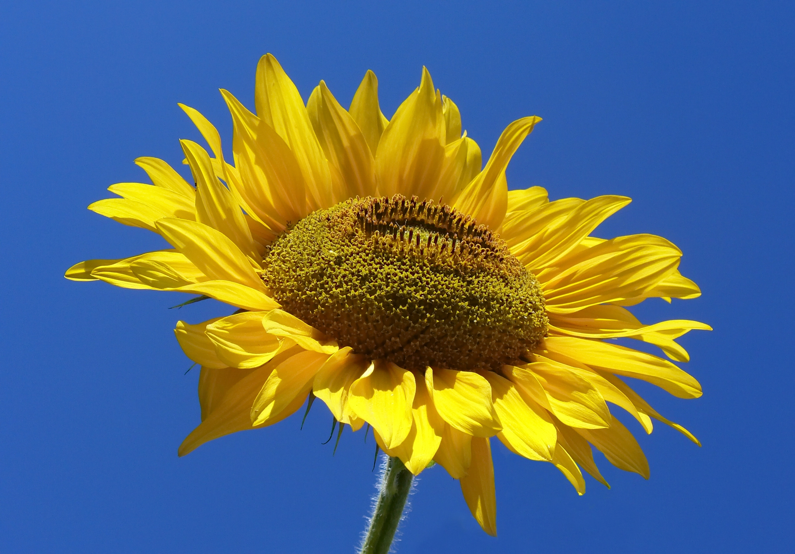
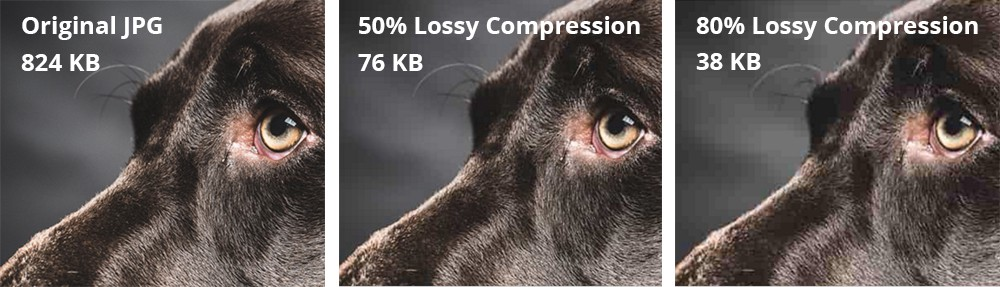

~.toc

- [Graphics Technologies](#graphics-technologies)
  - [Bitmap/raster graphics](#bitmapraster-graphics)
  - [Vector graphics](#vector-graphics)
  - [Compression](#compression)

/~

# Graphics Technologies

## Bitmap/raster graphics

<figure>
    
        
    
</figure>

Pixel-based images. Best for smooth gradients and natural images like photographs.

- JPEG
- PNG
- GIF
- WebP

~.focusContent.note

**Choosing a Raster Format**

| Format | Best For                                             |
| ------ | ---------------------------------------------------- |
| JPEG   | Photographs; smaller files, some quality loss        |
| PNG    | Images needing transparency; lossless                |
| GIF    | Simple animations; limited color palette             |
| WebP   | Modern general-purpose format; smaller than JPEG/PNG |

/~

## Vector graphics

<figure>
    
        
    
</figure>

Mathematical formula-based images. Best for simple shapes with hard edges (illustrations, logos, diagrams) and text.

- SVG

~.focusContent.exercise

**Examining an SVG Image**

Let's try saving the SVG image above and opening it in a text editor to see the mathematical formula that defines it!

/~

## Compression

Compression is the process of reducing the size of a file or data. This is useful for saving space and for transmitting data more quickly.

Compression isn't limited to images - general-purpose archive formats like ZIP and 7z compress any kind of file losslessly, while formats like MP3 (audio) and MP4/H.264 (video) use lossy compression to shrink media files.

<figure>
    
        
    
</figure>

There are two types of compression:

| Compression Type | Description                                                                                                                |
| ---------------- | -------------------------------------------------------------------------------------------------------------------------- |
| Lossless         | The original data can be perfectly reconstructed from the compressed data.                                                 |
| Lossy            | The original data cannot be perfectly reconstructed from the compressed data. Information is discarded during compression. |

It may seem as if we should always use lossless compression, but in many cases, the quality difference is not noticeable, and the file size is significantly reduced.

Lossy compression is most visible in JPEG images, where the image can become _pixelated_ at lower quality settings. These out of place pixels are called _artifacts_.

~.focusContent.lookout

**Sending High Quality Images**

If you've ever saved the image from a text message and tried to open it on a computer with a larger screen, you may have noticed that the image is pixelated. This is because the image was compressed using lossy compression for the smaller screen of the phone.

If you need to send a high quality image to someone, you should send the original image file, not a compressed version.

/~
