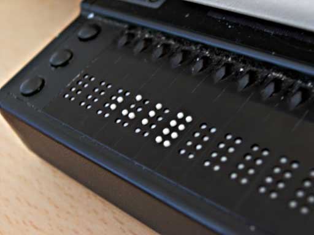
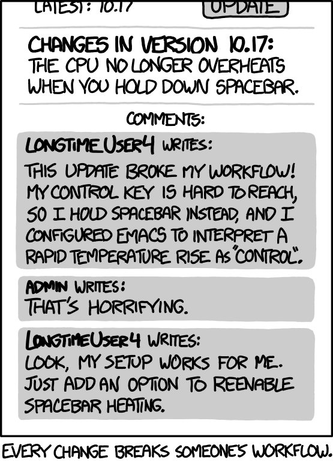

~.toc

- [Humans and Applications](#humans-and-applications)
  - [Usability](#usability)
  - [Accessibility](#accessibility)
  - [Why Good Software Gets Rejected](#why-good-software-gets-rejected)

/~

# Humans and Applications

## Usability

**Usability** is how easily and effectively people can use an application to reach their goals. Key qualities:

- **Learnability**: How quickly can a new user accomplish basic tasks?
- **Efficiency**: Once learned, how quickly can tasks be performed?
- **Error prevention**: Does the design make mistakes hard to make, and easy to recover from (e.g., undo, confirmation dialogs)?

## Accessibility

<figure>
    
        
    
    <figcaption>
        

        Source: <a href="https://commons.wikimedia.org/wiki/File:Refreshable_Braille_display.jpg">Wikimedia Commons</a> (CC BY-SA 3.0)
        

    </figcaption>
</figure>

**Accessibility** means that people with disabilities can use the application. Software should work with **assistive technology** such as:

- Screen readers (e.g., NVDA, JAWS, VoiceOver)
- Refreshable braille displays (pictured above)
- Screen magnifiers and high-contrast modes
- Voice control and alternative input devices

**Inclusive design** goes further - designing from the start for the full range of people who might use a product, rather than bolting on accessibility at the end.

~.focusContent.note

**Legal and Ethical Obligations**

In the U.S., the Americans with Disabilities Act (ADA) and Section 508 of the Rehabilitation Act set accessibility requirements. In 2024, the Department of Justice adopted a rule requiring state and local government web content and mobile apps - including those of public colleges - to meet the **WCAG 2.1 AA** standard.

Beyond the law: an inaccessible application excludes people from work, education, and services.

/~

## Why Good Software Gets Rejected

<figure>
    
        
    
    <figcaption>
        

        Source: <a href="https://xkcd.com/1172/">xkcd: Workflow</a> (CC BY-NC 2.5)
        

    </figcaption>
</figure>

Technically excellent software can still fail if people won't (or can't) use it. Common reasons:

- **Poor fit with workflow**: The software forces people to work in a way that doesn't match how the job is really done
- **Training gaps**: Users are given a login, but not the time or support to learn the system
- **Resistance to change**: People are comfortable with the old way, and the benefits of the new system aren't obvious to them

~.focusContent.example

**A Technically Sound System, Abandoned**

In 2003, Cedars-Sinai Medical Center in Los Angeles suspended a multimillion-dollar computerized physician order entry system only months after rollout. The system worked, but physicians objected that it slowed them down, interrupted them with too many alerts, and didn't match how they actually cared for patients.

The lesson: success is measured by whether people use the software to do their jobs - not by whether the software runs.

/~
