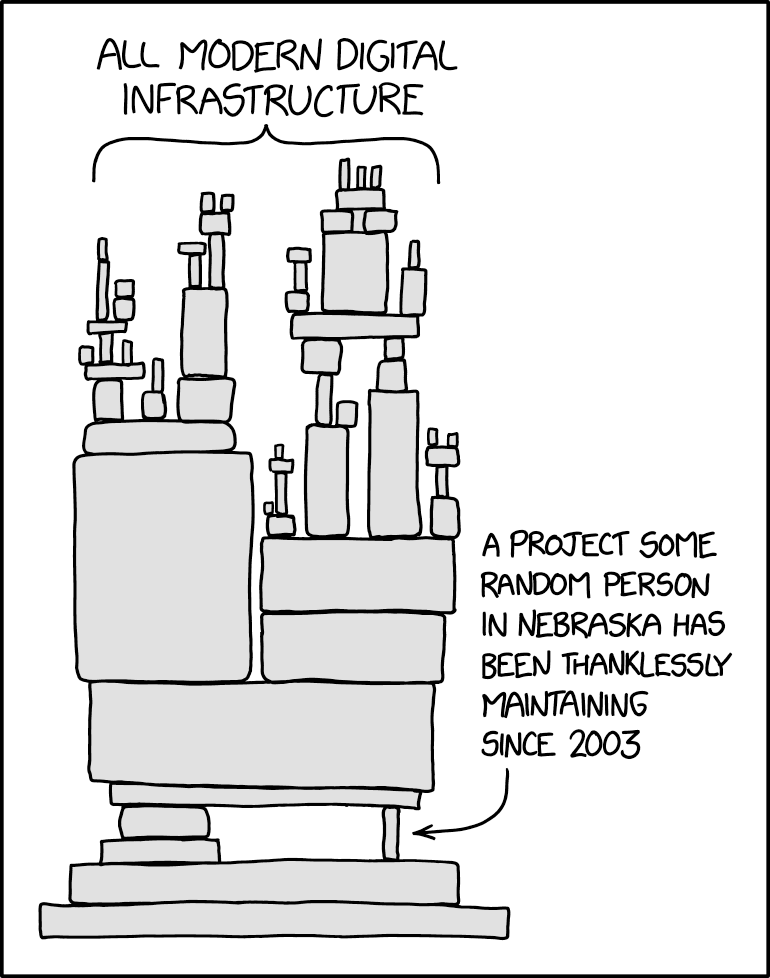

~.toc

- [Selecting and Adopting Software](#selecting-and-adopting-software)
  - [Commercial vs Open Source](#commercial-vs-open-source)
  - [Build vs Buy](#build-vs-buy)
  - [Licensing Models](#licensing-models)
  - [Total Cost of Ownership](#total-cost-of-ownership)
  - [Integration and Legacy Systems](#integration-and-legacy-systems)
  - [Change Management](#change-management)
  - [Software Updates and Versioning](#software-updates-and-versioning)

/~

# Selecting and Adopting Software

## Commercial vs Open Source

- **Commercial (closed source)** software is sold by a vendor that keeps the source code private. The vendor typically provides support, updates, and accountability.
- **Open source** software makes its source code publicly available to use and modify. It is often free to obtain, but support may come from a community or from a paid third party.

Free to download doesn't mean free to run - someone still has to install, support, and maintain it.

## Build vs Buy

Organizations can either **buy** an existing product, or **build** (or commission) custom software.

| Option | Advantages                                    | Disadvantages                                          |
| ------ | --------------------------------------------- | ------------------------------------------------------ |
| Buy    | Available now, proven, vendor handles updates | May not fit the workflow exactly; dependence on vendor |
| Build  | Fits the organization's exact needs           | Expensive, slow, and the organization must maintain it |

Most organizations buy for common needs (email, payroll) and consider building only for what makes them unique.

## Licensing Models

| Model        | How it works                                         | Example                                  |
| ------------ | ---------------------------------------------------- | ---------------------------------------- |
| Perpetual    | Pay once, use that version indefinitely              | Older boxed versions of Microsoft Office |
| Subscription | Pay monthly or yearly for continued access           | Adobe Creative Cloud, Microsoft 365      |
| Per-seat     | Pay per named user (or device)                       | Most business SaaS products              |
| Site license | One fee covers everyone at an organization or campus | A university-wide statistics package     |

## Total Cost of Ownership

The **Total Cost of Ownership (TCO)** is the full cost of a piece of software over its lifetime - not just the price tag.

- **Licenses**: The purchase or subscription price
- **Training**: Staff time spent learning the system
- **Support**: Help desk, vendor support contracts, IT staff
- **Migration**: Moving data out of the old system and into the new one
- **Integration**: Connecting the software to the organization's other systems

~.focusContent.exercise

**Check-In: Is Free Really Free?**

An office of 50 people is considering replacing a paid word processor with a free, open source alternative. List three costs that the office would still face.

/~

## Integration and Legacy Systems

<figure>
    
        
    
    <figcaption>
        

        Source: <a href="https://xkcd.com/2347/">xkcd: Dependency</a> (CC BY-NC 2.5)
        

    </figcaption>
</figure>

New software rarely arrives into an empty organization. It must work alongside **legacy systems** - older systems that are still in use because they are critical, expensive to replace, or nobody fully understands them anymore.

A new application that can't exchange data with the existing billing, scheduling, or student records systems creates double data entry and errors.

## Change Management

**Change management** is the people side of adopting software.

- **Stakeholders**: Identify everyone affected - end users, managers, IT, customers, patients - and involve them early
- **Training**: Plan for it, schedule it, and budget for it
- **Rollout strategies**:
  - **Big bang**: Everyone switches on the same day
  - **Phased**: One department or feature at a time
  - **Pilot**: A small group tries it first, and the lessons are applied before the full rollout
  - **Parallel**: The old and new systems run side by side for a period

~.focusContent.lookout

**The Riskiest Rollout**

A big-bang rollout is the fastest and cheapest - right up until something goes wrong. Then, everyone is affected at once, and there is no old system to fall back on.

/~

## Software Updates and Versioning

With **semantic versioning**, software versions are typically written as `MAJOR.MINOR.PATCH`.

- **Major version**: Significant changes to the software. Breaks backward compatibility. Other tools that use this software may not be able to use it after updating.
- **Minor version**: New features or improvements. Compatible with previous version.
- **Patch version**: Bug fixes and security updates. Compatible with previous version.

Software is also often labeled by release stage:

- **Alpha**: Early, unstable version for internal testing
- **Beta**: Feature-complete but still being tested; often released to a limited public audience
- **Release Candidate (RC)**: Believed ready for release, pending final testing
- **Long-Term Support (LTS)**: A release that receives updates and support for an extended period, favored for stability over having the newest features (e.g., Ubuntu LTS)

~.focusContent.lookout

**End-of-Life (EOL) Software**

Every version of software eventually stops receiving updates, including security patches. Running EOL software is a common cause of security breaches - if you're still using something past its support lifecycle, it's time to upgrade.

/~

~.focusContent.exercise

**Check-In: Major, Minor, or Patch?**

Match each change below to the correct type of version bump: **Major**, **Minor**, or **Patch**.

1. Fixed a typo in a menu label
2. Added a new "dark mode" setting that doesn't affect existing features
3. Changed a file input format; as a result, older versions of a connected tool can no longer open the old file format.

/~
