~.toc

- [What is AI?](#what-is-ai)
  - [AI vs Human Intelligence](#ai-vs-human-intelligence)
  - [AI in Daily Life](#ai-in-daily-life)
  - [Classical vs Modern AI: A Paradigm Shift](#classical-vs-modern-ai-a-paradigm-shift)
    - [Classical AI](#classical-ai)
    - [Modern AI](#modern-ai)
  - [Machine Learning](#machine-learning)
    - [Supervised Learning](#supervised-learning)
    - [Artificial Neural Networks](#artificial-neural-networks)
      - [Training](#training)
      - [Inference](#inference)

/~

# What is AI?

<figure>
 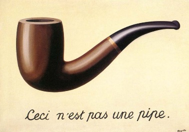
 <figcaption>
  <span class="attr">--Magritte, The Treachery of Images ("This is not a pipe")</span>
 </figcaption>
</figure>

**Artificial Intelligence** is the simulation of human intelligence processes by machines, especially computer systems.

It has been around for a long time, but has recently become more capable, and is seeing more widespread use.

## AI vs Human Intelligence

AI excels at:

- Processing large amounts of data quickly
- Finding patterns humans might miss
- Performing repetitive tasks consistently

AI struggles with:

- Common sense reasoning
- Understanding context like humans do
- Creative problem solving in new situations

## AI in Daily Life

"Traditional" uses of AI (have been going on for years):

<figure>
    <span>
        
    </span>
</figure>

**Smartphones**

- Predictive text and autocorrect
- Voice assistants (Siri, Google Assistant)
- Camera features (object framing and recognition, search in photo gallery)

**Social Media**

- News feed algorithms
- Friend suggestions
- Content recommendations

**Entertainment**

- Netflix/Spotify recommendations
- Video game AI opponents

**Navigation**

- GPS route optimization
- Traffic prediction

**Shopping**

- Product recommendations
- Fraud detection

## Classical vs Modern AI: A Paradigm Shift

The AI we use today is fundamentally different from earlier AI systems. This represents one of the most significant paradigm shifts in computing history.

<figure>
    <span>
        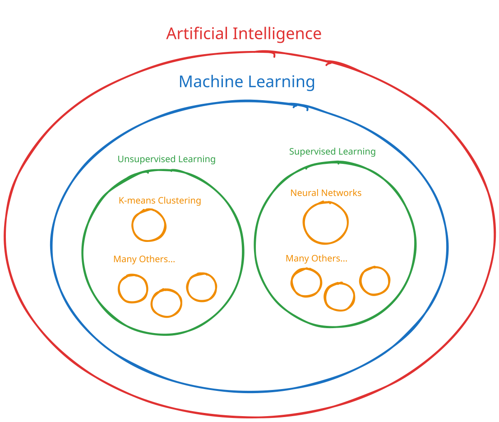
    </span>
</figure>

### Classical AI

**Approach**: Rule-based and heuristic systems

Classical AI systems were programmed with explicit rules:

```
- "If patient's blood pressure > 140/90, then flag for hypertension review"
- "If credit card transaction amount > $1000, then trigger fraud detection review"
```

These are called **expert systems**. These types of systems are still used today. They are important when we need a **deterministic** system, with no uncertainty in the output.

~.focusContent.example

<figure>
    <span>
        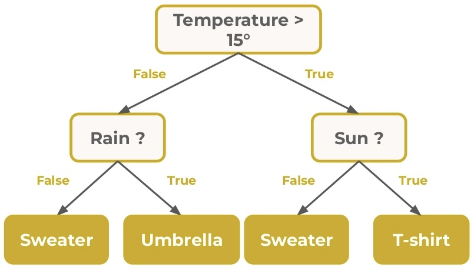
    </span>
</figure>

Here is a "recommender" system that might suggest products based on the current weather in the user's location. These decicion branches would be picked by a human.

/~

~.focusContent.example

**Video Game NPCs**

<figure>
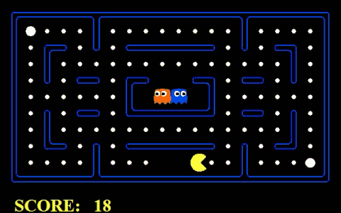
</figure>

The ghosts were "programmed" by a human to follow a set of rules based on

- The walls of the maze.
- The player's position.
- The position of other ghosts.

/~

### Modern AI

**Approach**: Data-driven learning systems

Modern AI systems learn patterns from data rather than following explicit rules. This allows them to handle complex, uncertain situations that would be difficult to program with traditional rules.

## Machine Learning

**Machine Learning** allows computer systems to learn from data, _without being explicitly programmed_.

Advances in machine learning techniques and technologies are what is driving the recent explosion of AI capabilities.

~.focusContent.note

**Key Insight: Learning vs Programming**

The fundamental difference between classical and modern AI is how they acquire their capabilities:

- Classical AI: Explicitly programmed with rules by humans
- Modern AI: Learns patterns from data through training

This shift from programming to learning is what makes modern AI so powerful and flexible.

/~

### Unsupervised Learning

In unsupervised learning, there are no labeled "solutions" for the problem. These types of algorithms are exploratory in nature.

- Break a set of data points into clusters
- "Customers like you also bought..."

#### K-Means Clustering

**K-Means Clustering** is a type of unsupervised learning algorithm that clusters data points into related groups.

The algorithm works like this:

- Pick some random starting center points, one for each grouping (cluster).
- Assign each data point to the nearest center point to make the groups.
- Update the center points by choosing a new point within each group that minimizes distances of its group members.
- Repeat until the center points stop moving.

[K-Means++ Example](https://github.com/mpjovanovich/k-means_plus_plus)

<figure>
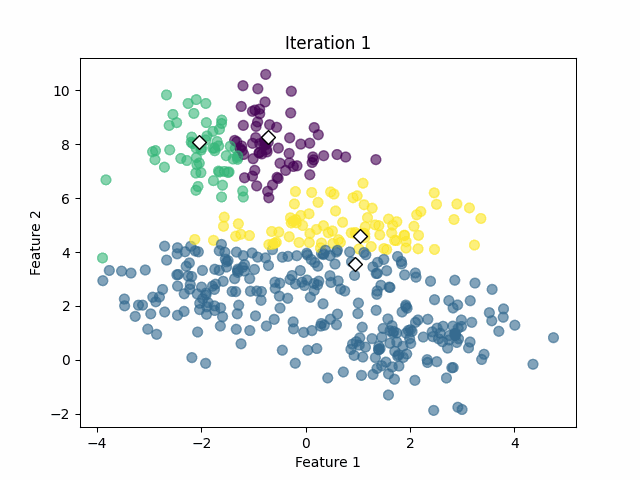
</figure>

### Supervised Learning

- Supervised learning is a type of machine learning where the model is trained on a labeled dataset
- The model learns to map inputs to outputs based on the correctly labeled data
- Inputs are called "features" or **parameters**
- The model is then used to predict the output for new inputs that it has not seen before

#### Artificial Neural Networks

<figure>
 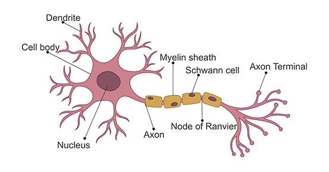
</figure>

**Artificial Neural Networks** are a type of _supervised learning_ model inspired by the human brain.

These have been around since the 1950's, but only recently have they become practical due to the availability of data and compute volume.

#### Training

<figure>
    <span>
        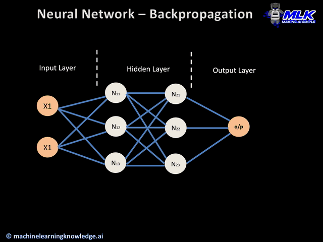
    </span>
</figure>

The process of creating a neural network model is called the **training** process. This is where the learning happens.

In this phase the model is given a set of input/output pairs, and it learns to map the inputs (e.g. picture of a cat) to the outputs (e.g. "cat").

After the model has been trained, it is released to the public, e.g. ChatGPT. These models do not learn after this point.

~.focusContent.note

**Key Insights:**

- The model learns by itself through trial and error, using labeled data to adjust its weights until it can make accurate predictions.

<figure>
    <span>
        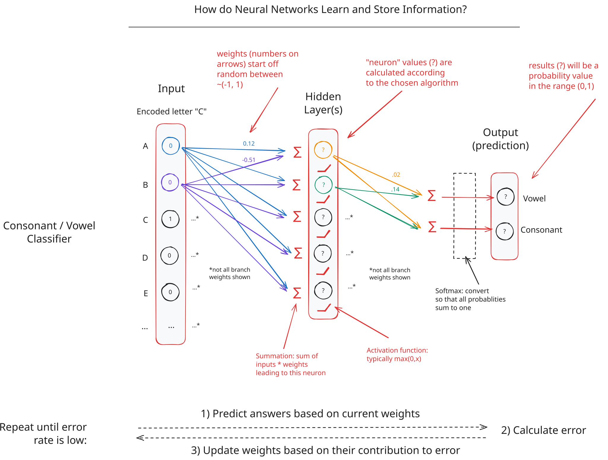
    </span>
</figure>

/~

#### Inference

<figure>
 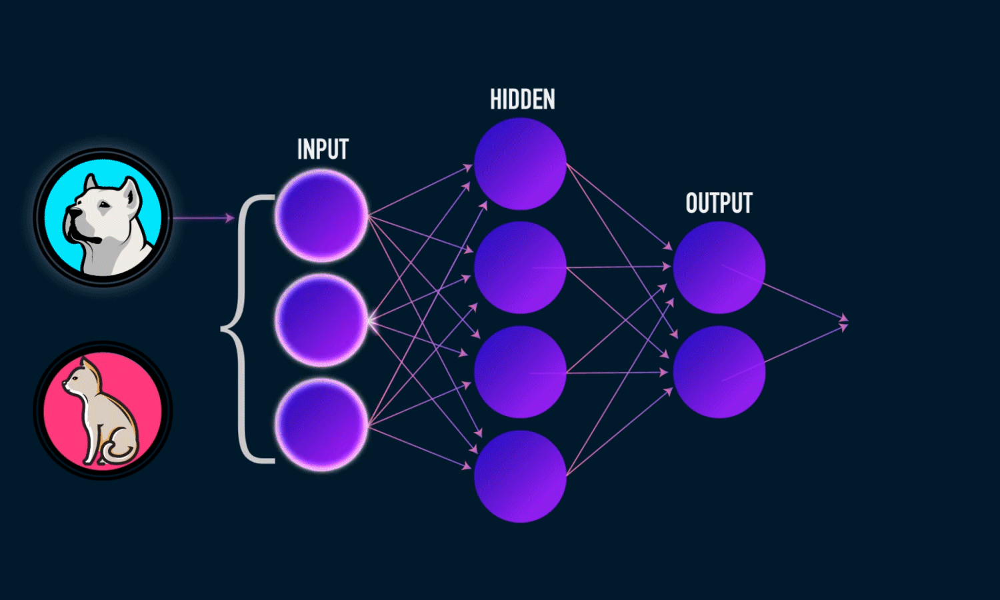
</figure>

<figure>
 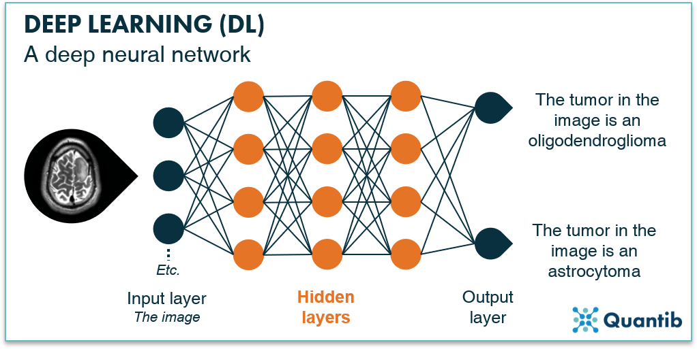
</figure>

By the time a model is released to the public, it is completely done learning.

The process of using the model to make predictions is called **inference**.

~.focusContent.note

**Key Insight: Generalization**

The distinguishing feature of neural networks is the ability to "understand" data that it has not seen before.

- Image classification (medical diagnosis, self-driving cars, photo gallery search)
  - Model has never seen _your_ cat, but it knows it's a cat
- Speech recognition (voice assistants, dictation software)
  - Model has never heard _your_ voice, but it knows your words

This ability to generalize from training data to new situations is what makes neural networks so powerful.

/~

~.focusContent.demo

**Walking throuth the Training Process**

In this demo we train the model to learn the truth table for "logical AND".

[Neural Network: Logical AND](https://github.com/mpjovanovich/ivy_tech/blob/main/demos/nn_logical_and_step.py)

This is our training set:

| Input1 | Input2 | Result |
| ------ | ------ | ------ |
| T      | T      | T      |
| T      | F      | F      |
| F      | T      | F      |
| F      | F      | F      |

Over many rounds of training, the model will update itself so that it produces the correct answers without that logic being hardcoded anywhere.

/~

~.focusContent.exercise

**Calculating the Activation Value of a Neuron**

The example below shows how one-hot encoding is used in a very basic neural network.

<figure>
    <span>
        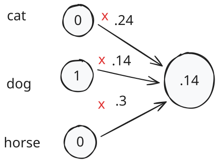
    </span>
</figure>

For today's checkin your instructor will alter the weights and input vector. You must calculate the activation value.

/~
