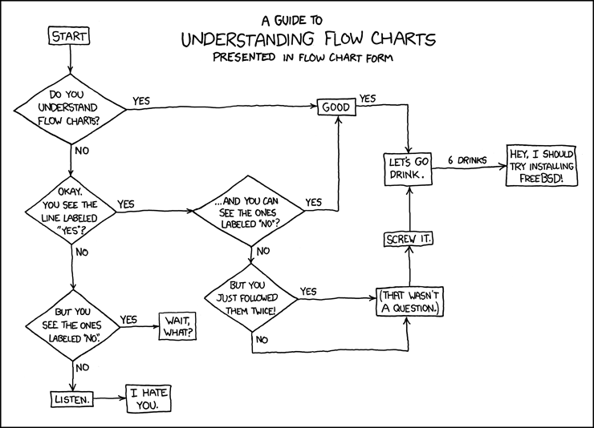
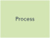
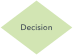
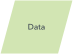
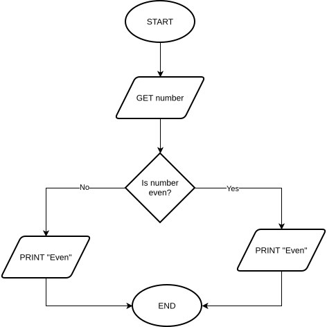
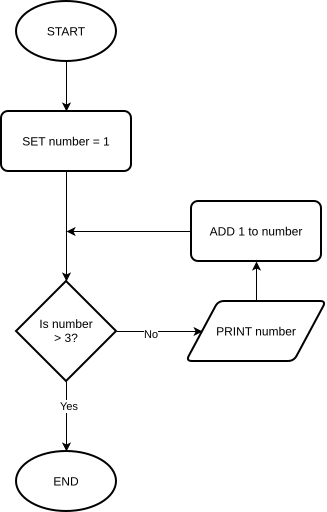
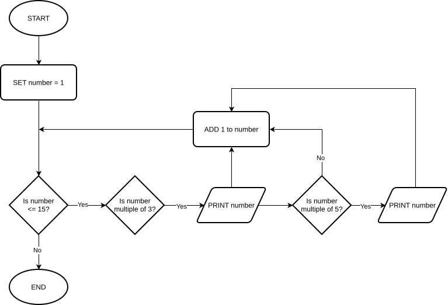
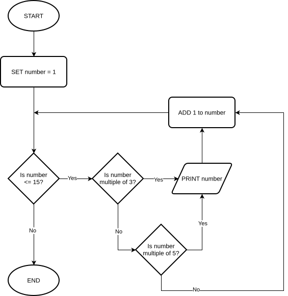

~.toc

- [Flowcharts](#flowcharts)
  - [Flowchart Symbols](#flowchart-symbols)
    - [Terminator](#terminator)
    - [Flow Arrow](#flow-arrow)
    - [Process](#process)
    - [Decision](#decision)
    - [Input / Output](#input--output)
    - [Data Store](#data-store)
  - [Examples and Exercises](#examples-and-exercises)

/~

# Flowcharts

<figure>
  
</figure>

A flowchart is a visual representation of a process.

Flowchart symbols are standardized, the way the text is written is not.

## Flowchart Symbols

### Terminator

<figure>
 
</figure>

- Oval or rounded rectangle.
- Indicates the start or end of a process.

### Flow Arrow

<figure>
 
</figure>

- Arrow connecting two symbols.
- Indicates the flow of the process.

### Process

<figure>
 
</figure>

- Rectangle.
- Represents a process, action, or operation.
- Also represents assignment of a value.
- Typically contains a verb.
- Examples:
  - "Calculate total"
  - "Print invoice"
  - "Add new customer"
  - "Set balance = 0"
  - "balance = 0"
  - "balance := 0"

### Decision

<figure>
 
</figure>

- Represents a decision point.
- Branches to different parts of the flowchart based on a condition.
- Branches are labeled
  - "Yes" or "No"
  - "True" or "False"
- Possible ways to express a decision:
  - "Is the customer a member?"
  - "Customer is member?"
  - "Is the balance over $1000?"
  - "Balance > $1000?"

### Input / Output

<figure>
 
</figure>

- Represents input or output.
- May have arrow pointing to or from the symbol.
  - Arrow connecting on the left side is input.
  - Arrow stemming from the right side is output.
- Input can be a variable assignment.

_Input Example:_

- "input customer name"
- "enter customer name"
- "-> customer name"
- "customer name"

_Output Example:_

- "print total"
- "display total"
- "output total"

### Data Store

<figure>
 
</figure>

- Cylinder
- Represents a data store
  - Database
  - File

## Examples and Exercises

~.focusContent.demo

_Determine if a number is even or odd and print the result_

<figure>
 
</figure>

/~

~.focusContent.demo

_Print every number from 1-3 inclusive (1, 2, 3)_

<figure>
 
</figure>

What is another way that we might have asked "is number > 3" to control entry into the conditional part of the algorithm?

- Could we have used its negation?

/~

~.focusContent.exercise

**Spot the difference**

Only one of these algorithms is correct. How will the incorrect version fail?

Hint: The failure will happen when the number reaches 15. Try walking through them both with 15 as the input.

_Print all numbers between 1 and 15 inclusive that are multiples of either three or five_

The output should be: 3, 5, 6, 9, 10, 12, 15

**_v1_**

<figure>
 
</figure>

**_v2_**

<figure>
 
</figure>

/~

~.focusContent.exercise

_Flowchart password validation algorithm_

We will do this together using [draw.io](https://draw.io) for the assignment today.

This algorithm is used to check if a password is correct.

To keep things simple, we will assume that the password is hardcoded as "CORRECT".

```
START
    GET password

    WHILE password is not "CORRECT":
        IF password is blank:
            PRINT "Password cannot be blank"
        ELSE:
            PRINT "Incorrect, try again"
        END IF

        GET password
    END WHILE

    PRINT "Welcome!"
END
```

_Note:_ The flowchart for this algorithm does not make use of the "process" symbol, but many algorithms will. Be sure to know the difference between input/output and a process.

/~
